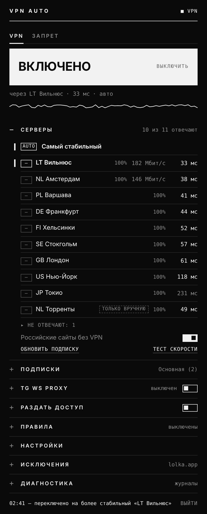
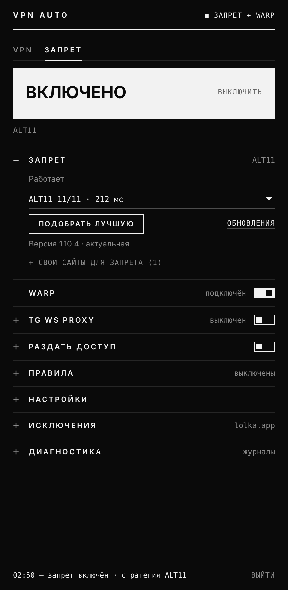
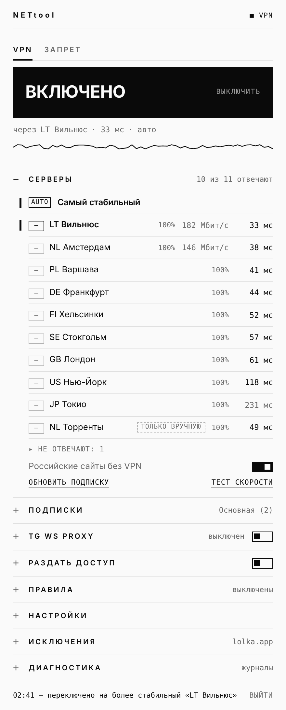
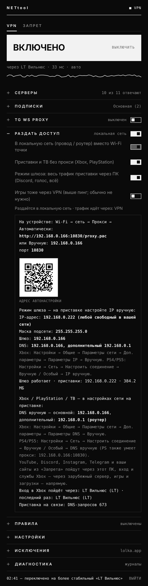
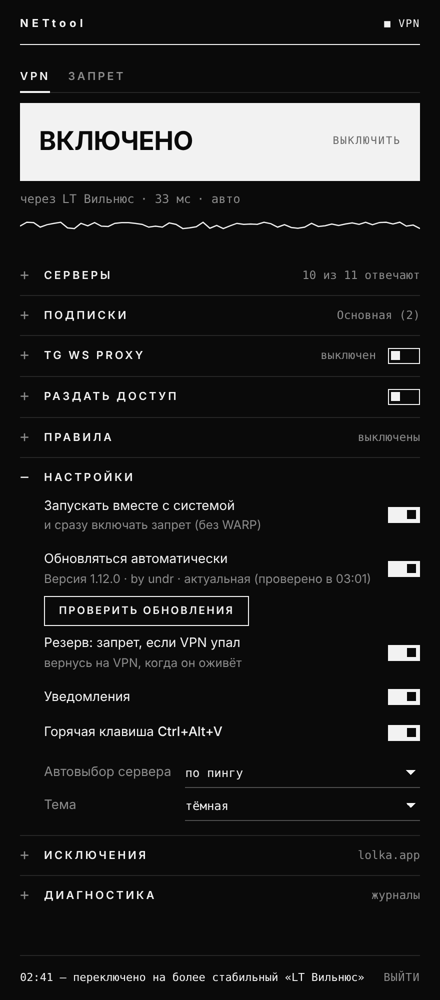
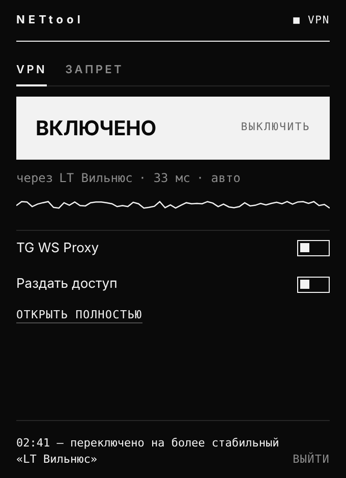

# NETtool

**Автоматический выбор лучшего VPN-сервера из любой подписки + обход блокировок без VPN (запрет, WARP) + раздача интернета на телефоны, Xbox и PlayStation.**
Windows 10/11 и macOS 11+ (Intel и Apple Silicon). Автор — **undr**.

> Чёрно-белый минималистичный интерфейс, значок в трее, автообновление.
> Подписка (ваш ключ) хранится только у вас на компьютере и никуда не отправляется.

<p align="center">
  
  
  
</p>
<p align="center">
  
  
  
</p>
<p align="center"><sub>Слева направо: VPN с автовыбором · запрет + WARP · светлая тема · приставки (DNS и режим шлюза) · настройки и автообновление · мини-окно у трея. Названия серверов — демонстрационные.</sub></p>

## ⬇️ Скачать

| | |
|---|---|
| **Windows 10/11** | **[NETtool-Setup.exe](../../releases/latest/download/NETtool-Setup.exe)** — скачать и запустить |
| **macOS 11+** | **[NETtool-macOS.zip](../../releases/latest/download/NETtool-macOS.zip)** |
| Все файлы | [страница выпусков](../../releases/latest) |

> Кнопка «Code → Download ZIP» скачивает **исходный код**, а не программу. Для установки нужен файл выше.

---

## Содержание
- [Установка](#установка)
- [Возможности](#возможности)
  - [VPN: автовыбор сервера](#vpn-автовыбор-сервера)
  - [Подписки любого формата](#подписки-любого-формата)
  - [Запрет (без VPN)](#запрет-без-vpn)
  - [Cloudflare WARP](#cloudflare-warp)
  - [TG WS Proxy](#tg-ws-proxy)
  - [Раздача интернета](#раздача-интернета)
  - [Xbox и PlayStation](#xbox-и-playstation)
  - [Правила, резерв, исключения](#правила-резерв-исключения)
  - [Трей, мини-окно, горячая клавиша](#трей-мини-окно-горячая-клавиша)
  - [Автообновление](#автообновление)
- [Как это устроено](#как-это-устроено)
- [Сборка из исходников](#сборка-из-исходников)
- [Частые вопросы](#частые-вопросы)
- [Благодарности](#благодарности)

---

## Установка

Скачайте установщик по ссылке в разделе [«Скачать»](#️-скачать) или со страницы **[Releases](../../releases/latest)** (справа на главной странице репозитория).

### Windows
1. Запустите `NETtool-Setup.exe`. Если появится «Windows защитила ваш компьютер» — «Подробнее» → «Выполнить в любом случае» (программа не подписана платным сертификатом).
2. В установщике выберите папку и нужные компоненты: ярлык, автозапуск, запрет, WARP, TG WS Proxy.
3. Вставьте ссылку на подписку (или ключ `vless://…`) → «Сохранить» → большая кнопка «Включить».

Удаление: «Параметры» → «Приложения» → NETtool.

### macOS
1. Распакуйте `NETtool-macOS.zip`, откройте «NETtool».
2. Если macOS не даёт открыть: «Системные настройки» → «Конфиденциальность и безопасность» → «Всё равно открыть». Если пишет «повреждена» — в Терминале: `xattr -cr "/путь/к/NETtool.app"`.
3. Программа сама предложит переместиться в «Программы».

Архив `NETtool-<версия>.zip` — то же самое для раздачи друзьям: Windows + macOS + инструкция.

---

## Возможности

### VPN: автовыбор сервера
- Каждые 10 секунд проверяет **все** серверы подписки через само ядро Xray (настоящий запрос через туннель, а не просто пинг адреса).
- Выбирает не самый быстрый «на миг», а самый **стабильный**: учитывает средний пинг и обрывы за последние минуты.
- Сервер упал — переключение на другой за несколько секунд, без ручных действий.
- При запуске сразу подключается к серверу, на котором работала до закрытия, — без ожидания проверки.
- Серверы для торрентов/P2P и служебные строки подписки («осталось N ГБ», «продлить» и т.п.) не выбираются автоматически — только вручную.
- Серверы в **СНГ** (Беларусь, Россия, Казахстан и др.) тоже не выбираются автоматически: от российских блокировок они не спасают. Страна определяется по флагу в названии и по реальному адресу выхода (проверка через Cloudflare).
- Можно закрепить сервер вручную, выбрать автовыбор «по скорости» (после теста скорости).
- «Российские сайты без VPN» — `.ru`, `.рф` и российские IP напрямую.
- Работает как системный прокси; подписка загружается при старте и обновляется каждые 2 часа, при недоступности — используется сохранённый список.
- Совместимость: если в подписке есть `vless` без шифрования (новые версии Xray их запрещают), программа сама переходит на совместимую версию ядра и подстраивает настройки остальных серверов.

### Подписки любого формата
- Ссылки: `vless://`, `vmess://`, `trojan://`, `ss://`, `hysteria2://` / `hy2://` (включая obfs salamander), `wireguard://` / `wg://`.
- Наборы ссылок в base64 (как у v2rayN, Happ, Hiddify, Streisand).
- JSON: конфиги Xray, **sing-box** (`outbounds`), SIP008 (Shadowsocks).
- **Clash / Mihomo YAML** (раздел `proxies:`), включая `reality-opts`, `ws-opts`, `grpc-opts`.
- Транспорты: TCP, WebSocket, gRPC, XHTTP/HTTPUpgrade, REALITY, TLS, Vision.
- Несколько подписок (профилей) с быстрым переключением.

### Запрет (без VPN)
Режим «Запрет» — обход замедлений и блокировок **без VPN-сервера**, на полной скорости вашего интернета: YouTube, Discord (включая голос), Instagram, Telegram, Кинопаб, TikTok и др.
- Основан на [zapret-discord-youtube](https://github.com/Flowseal/zapret-discord-youtube) (winws / WinDivert).
- При первом включении сам проверяет все стратегии (2–3 минуты) и оставляет лучшую; «Подобрать заново» — одной кнопкой.
- Свои сайты можно добавить в список прямо в окне.
- Обновляется сам, когда выходит новая версия.
- После установки включается без запросов прав администратора (через задачу планировщика).
- VPN и запрет одновременно не работают — переключатель «VPN / Запрет» под кнопкой.

### Cloudflare WARP
- «WARP через запрет»: WARP шифрует весь трафик, а запрет пропускает его подключение.
- Скачивается, устанавливается и обновляется автоматически.
- Максимальная совместимость: если WARP не подключается, программа перебирает протоколы (MASQUE / WireGuard) и порты, пока какой-то вариант не пройдёт; ход подключения виден в окне.
- По умолчанию выключен; при автозапуске с Windows включается **запрет без WARP**.

### TG WS Proxy
Ускорение Telegram Desktop через [tg-ws-proxy](https://github.com/Flowseal/tg-ws-proxy): скачивается, запускается и обновляется сам; кнопка «Подключить Telegram» добавляет прокси в Telegram. При включении VPN выключается автоматически (его можно включить вручную).

### Раздача интернета
- Wi-Fi точка доступа Windows или раздача в локальную сеть (по проводу/через роутер), если точка не поддерживается.
- Устройства получают тот же доступ, что и компьютер: VPN, запрет или запрет + WARP.
- Для телефонов — прокси с автонастройкой (`proxy.pac`) и QR-коды: подключиться к сети и адрес автонастройки.

### Xbox и PlayStation
Два режима — можно включить оба:

**Приставки и ТВ без прокси (DNS-режим).** На приставке вписывается DNS компьютера. YouTube, Discord, Instagram, Telegram и ваши сайты из «Запрета» идут через компьютер, игры — напрямую.

**Режим шлюза** — весь трафик приставки через компьютер, как у GearUP: голос Discord, сервисы, всё. На приставке вручную задаются IP, маска, **шлюз = компьютер** и DNS (программа показывает, что вписать). Трафик выходит с компьютера: через VPN (режим VPN) или через запрет/WARP (режим запрета). Игры по умолчанию идут напрямую — пинг не растёт. Если программа закрыта, приставка продолжает выходить в интернет через компьютер напрямую.

**Ошибка Xbox 0x80a40401 «Вы находитесь в регионе, где эта служба недоступна».** Microsoft не пускает в учётную запись с российских адресов. Программа сама узнаёт страну каждого VPN-сервера и ведёт службы аккаунта Xbox (вход, Xbox Live, магазин, Game Pass) только через **зарубежный** сервер — в обоих режимах, даже когда компьютер работает на запрете. Скачивание игр идёт напрямую. В окне видно, через какую страну идёт вход.

> WARP сам по себе ошибку региона не исправит: Cloudflare подбирает адрес выхода той же страны, что и у пользователя. Поэтому для входа Xbox нужен хотя бы один зарубежный сервер в подписке.

Есть журнал адресов, к которым обращается приставка (`console-dns.log`), и журнал шлюза — для диагностики.

### Правила, резерв, исключения
- **Резерв** (по умолчанию включён): если все VPN-серверы недоступны — временно включается запрет; VPN оживёт — программа вернёт VPN.
- **Правила**: какой режим включать в домашней сети и в чужих; расписание включения/выключения.
- **«Не трогать эти сайты»** — домены, для которых программа ничего не меняет ни в одном режиме (по умолчанию `lolka.app`).
- **Автозапуск** с Windows: сразу включается запрет без WARP.

### Трей, мини-окно, горячая клавиша
- Значок-ключ в трее: левый клик — мини-окно, двойной — полное окно, правый — меню со всеми функциями.
- `Ctrl+Alt+V` — включить/выключить.
- Уведомления о переключениях, тест скорости, светлая/тёмная тема.
- «Выход» полностью закрывает программу и все её окна.

### Автообновление
Программа проверяет выпуски на GitHub (через минуту после запуска и затем каждые 6 часов). Новая версия скачивается, **проверяется по SHA-256** из `SHA256SUMS.txt` выпуска и ставится тихо поверх — настройки, подписка и режим сохраняются. Отключается в «Настройках»; там же кнопки «Проверить обновления» и «Обновить».

---

## Как это устроено

| Часть | Что делает |
|---|---|
| `app/` | Программа на Go без внешних зависимостей. Интерфейс — `ui.html`, открывается как окно приложения Edge/Chrome (`127.0.0.1:47321`). |
| Ядро | [Xray-core](https://github.com/XTLS/Xray-core) скачивается при первом запуске. На каждый сервер — свой локальный вход (HTTP и SOCKS5 с UDP), общий прокси на `127.0.0.1:10820`. |
| Запрет | winws + WinDivert из zapret-discord-youtube; управление через задачу планировщика с правами администратора (один запрос UAC при установке). |
| Приставки | Свой DNS-сервер (UDP/TCP 53) + прокси по имени сайта (SNI/Host); режим шлюза — перехват пересылаемых пакетов через WinDivert и прозрачный прокси (TCP/UDP). |
| `setup/` | Установщик (Go + окно WinForms в стиле программы), вшивает программу, запрет и TG WS Proxy; режим `--silent` для автообновления. |
| macOS | Универсальный `.app` (Intel + Apple Silicon), значок в строке меню. Запрет/WARP/раздача — только Windows. |

Данные программы: Windows — `%LOCALAPPDATA%\VPNAuto` (настройки, журналы `app.log`, `core.log`, `zapret.log`, `gateway.log`, `console-dns.log`), macOS — `~/Library/Application Support/VPNAuto`.

---

## Сборка из исходников

Нужно: Go 1.24+, Python 3, `zip`, `curl` (Linux, macOS или WSL).

```bash
./build.sh
```

Результат в `dist/`: `NETtool-Setup.exe`, `NETtool-macOS.zip`, архив для раздачи и `SHA256SUMS.txt`. Скрипт сам скачает вшиваемые компоненты (запрет, TG WS Proxy) и прогонит тесты (`go test ./app`).

Выпуск новой версии: поднять `appVersion` в `app/main.go` и `version` в `setup/main.go`, добавить описание в `docs/release-notes/vX.Y.Z.md` и отправить изменения в `main` — GitHub Actions увидит новую версию, сам соберёт программу и опубликует Release со всеми файлами. Программы у пользователей обновятся сами.

---

## Частые вопросы

**Серверы «0 из N отвечают».** Серверы подписки недоступны из вашей сети (сбой у провайдера VPN или блокировка). Включите «Запрет» — резерв делает это сам.

**Исключения Защитника.** В установщике есть галочка «Добавить в исключения Защитника» (по умолчанию включена), для уже установленной программы — кнопка «Добавить NETtool в исключения Защитника Windows» в разделе «Диагностика». После обновлений исключения прописываются заново автоматически.

**Антивирус ругается на программу.** Это ложное срабатывание: программа не подписана платным сертификатом, меняет системный прокси, создаёт задачу планировщика и скачивает ядро Xray — так же, как и другие VPN-клиенты. Начиная с 1.11.0 в установщике нет сторонних программ, а у файлов есть сведения о версии и авторе — срабатываний заметно меньше. Если антивирус всё же ругается:
- добавьте папку программы (по умолчанию `%LOCALAPPDATA%\Programs\NETtool`, у обновившихся с VPN Auto — `...\Programs\VPN Auto`) и папку данных `%LOCALAPPDATA%\VPNAuto` в исключения: «Безопасность Windows» → «Защита от вирусов и угроз» → «Управление настройками» → «Исключения»;
- отправьте файл на проверку в Microsoft как ложное срабатывание: https://www.microsoft.com/wdsi/filesubmission — после проверки Защитник перестаёт ругаться у всех.

**Защитник удалил winws.exe / WinDivert (запрет).** Это известное ложное срабатывание на сам zapret. Добавьте папку `zapret` внутри папки программы в исключения (см. выше).

**Все серверы «ядро не принимает соединения».** Ядро VPN не запустилось или его остановил антивирус. Программа сама подбирает свободные порты и пишет причину; если пишет про антивирус — добавьте папки в исключения (см. выше).

**Перед включением** отключите Happ или другой VPN — они мешают друг другу.

**iOS/Android** — не поддерживаются как отдельное приложение; телефоны можно подключить через раздачу.

---

## Благодарности
- [Xray-core](https://github.com/XTLS/Xray-core) — ядро VPN.
- [zapret](https://github.com/bol-van/zapret) и [zapret-discord-youtube](https://github.com/Flowseal/zapret-discord-youtube) — обход блокировок.
- [tg-ws-proxy](https://github.com/Flowseal/tg-ws-proxy) — ускорение Telegram.
- [Cloudflare WARP](https://one.one.one.one/) и [WinDivert](https://github.com/basil00/WinDivert).

Сторонние компоненты распространяются по своим лицензиям и скачиваются/вшиваются как есть.

---

© undr
